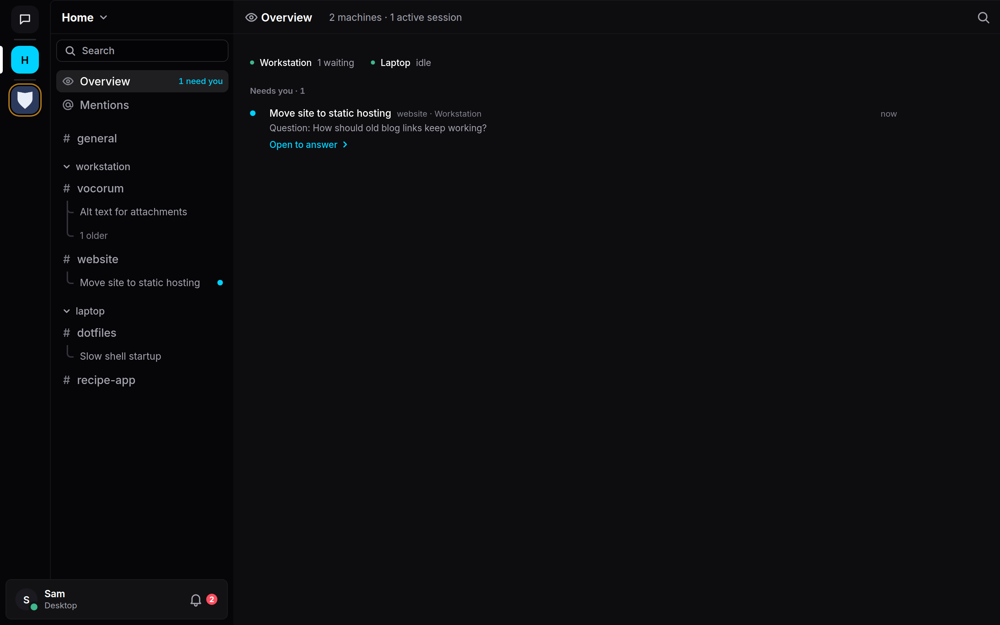
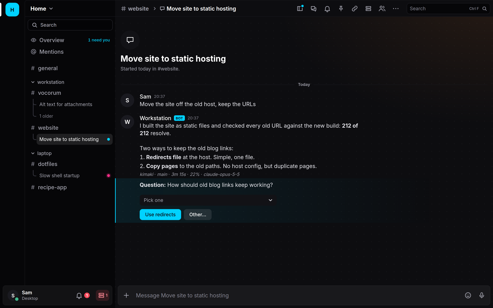
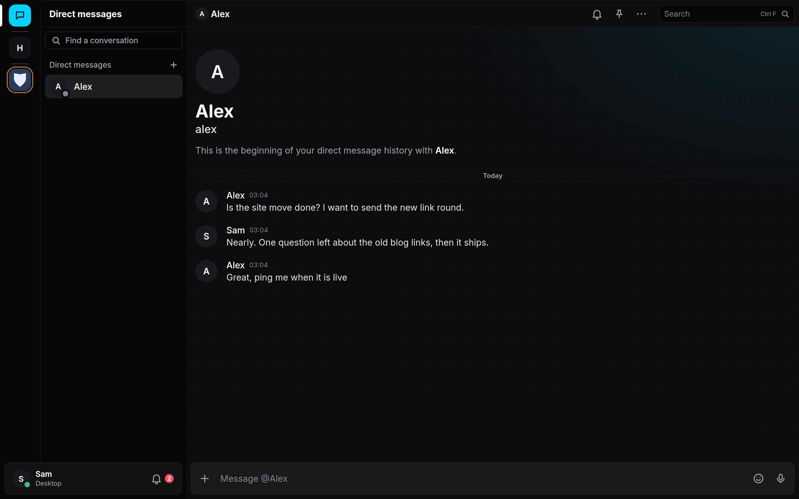
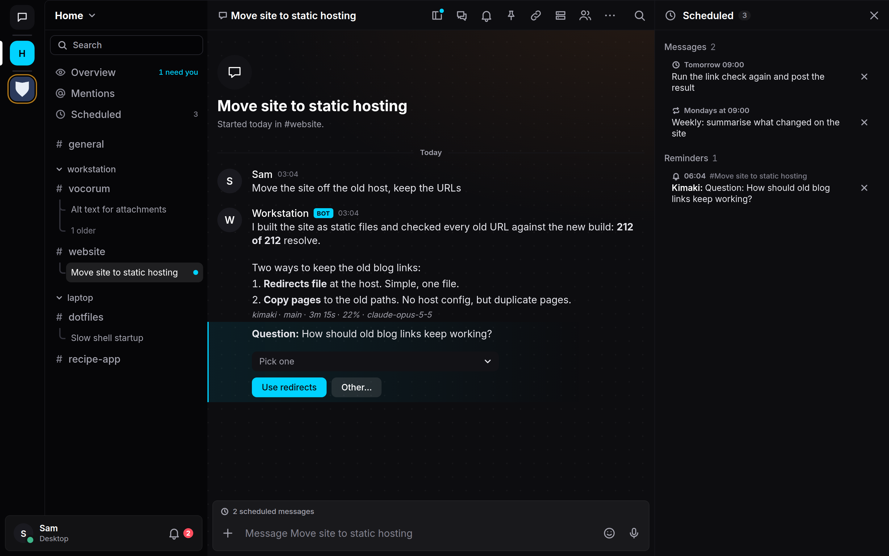
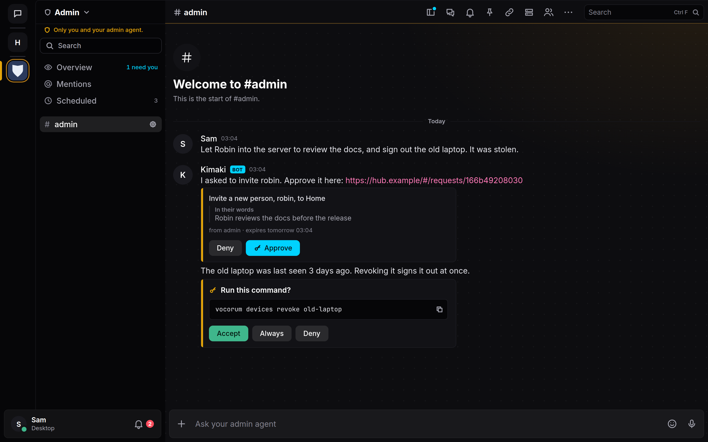
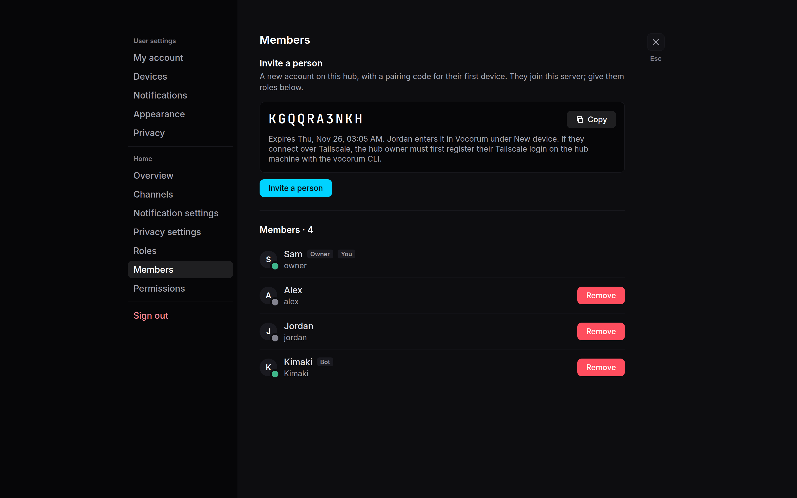
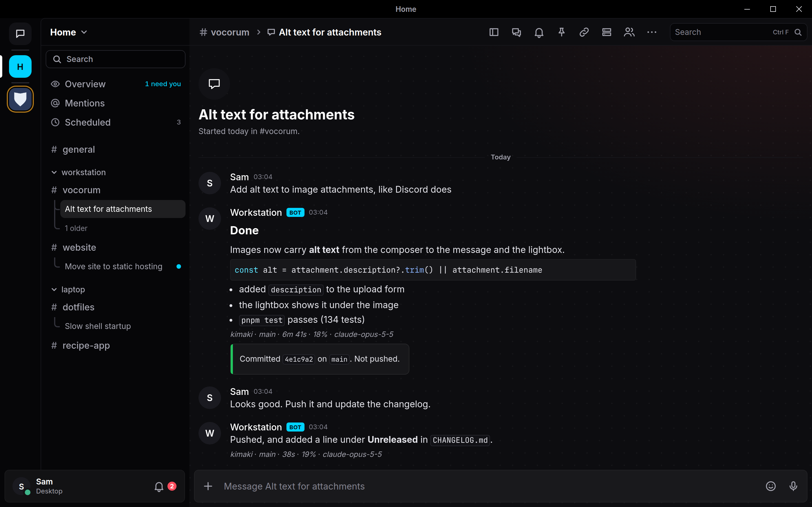

# Vocorum

Your own private Discord, for you and your bots.

Vocorum runs on your computer. Bots written for Discord (discord.js, for example
[Kimaki](https://github.com/remorses/kimaki)) connect to it unchanged. You chat
with them from an app on your phone and computers. Nothing goes through Discord
or any other company.


> **Early preview.** Expect rough edges and breaking changes. Known issues:
>
> - On iPhone, signing in and reading work. Sending messages and notifications
>   from the Home Screen app have not been confirmed yet.

## What it does

- Servers, channels, threads, buttons, menus, slash commands, files and voice
  notes, like Discord.
- One overview of every machine and every session, and which ones need you.
- Direct messages, reminders and scheduled messages.
- An Admin server where you ask your own agent to run the hub, and approve each
  change.
- An app for your phone and computer, signed in with a passkey per device.
- One small program with its data in one folder. No Docker, no database server.

<p>
  
  
</p>
<p>
  
  
</p>
<p>
  
  
</p>
<p>
  
  
</p>

## Get started

- [Try it on this computer](docs/try-it.md): the quickest start, with no certificate, code or passkey.
- [Install](docs/install.md): set up the hub and your first device.
- [Security levels](docs/security-levels.md): start open and add protection when you need it.
- [Move from Discord](docs/migrate-from-discord.md): bring your bots and history over.
- [Daily use](docs/daily-use.md): sessions, notifications, people and machines.
- [Back up and recover](docs/recovery.md): keep a copy and bring the hub back.
- [Leaving Vocorum](docs/leaving.md): export your messages and uninstall.
- Using an AI agent to set it up? Point it at [AGENTS.md](AGENTS.md).

Runs on Linux, macOS and Windows. Needs Node.js 22.16 or newer and git. Setup
installs and builds the rest.

```bash
git clone https://github.com/Xipzer/vocorum && cd vocorum
node bin/vocorum.js setup
```

Setup prints a link and a QR code to sign in your first device.

## Desktop and iPhone apps



Small native apps for Windows, macOS and Linux, and an iPhone build, wrap the
same UI. The UI is built into the app, the app trusts only your hub's own
certificate, and it signs in with a device key kept in the system keychain.
Closing the window leaves a tray icon that still gets alerts. Updates come from
your own hub and install only if they carry the publisher's signature. See
[apps/desktop/README.md](apps/desktop/README.md).

Get an app from your hub: run `vocorum pair <device> --app` and open the link
on that device. Or build it with `apps/desktop/scripts/release.sh`. The first
download comes over the hub's plain setup page, so do it over Tailscale or
WireGuard, not an open network.

> The apps are not signed by Apple or Microsoft yet. Windows shows "unknown
> publisher" on first install, and the Mac build is not notarised. The apps
> README explains the one-time warning. On Linux, both the `.deb` and the
> AppImage update themselves from your hub (the `.deb` asks for your password).

Measured against Discord's desktop app on the same machines (memory as the
system reports it, CPU averaged over two minutes idle):

| | Vocorum app | Discord |
|---|---|---|
| Windows 11: installer, installed | 2.6 MB, 6.8 MB | 549 MB installed |
| Windows 11: idle, window open | 87 MB, 0.3% CPU | 698 MB, 1.5% CPU |
| macOS (Apple silicon): app size | 5.3 MB | 481 MB |
| macOS: idle, window open | 77 to 131 MB, 0.5% CPU | 869 MB, 1.3% CPU |
| Linux (Ubuntu 24.04): package | 3.8 MB `.deb`, 8 MB installed; AppImage about 83 MB (carries WebKitGTK) | 466 MB after its first download |
| Linux: idle, window open | 309 to 334 MB, 2.3% CPU | 630 MB, 0.3% CPU (login screen only) |
| Window closed, tray only | 5 to 44 MB, 0% CPU | no equivalent |
| Windows 11: minimised | about 36 MB | |

The Windows run used a small test hub. The Mac screen was locked, so neither
app was drawing. On Linux, Discord was never logged in, and the numbers come
from WSL2, where WebKitGTK has no GPU.

## Privacy and security

Vocorum only listens on your own machine, or on one private network address you
choose. It is never meant to be on the public internet. Every device signs in
with its own passkey, and you can sign any device out. See
[SECURITY.md](SECURITY.md) for the details and how to report a problem.

## Development

```bash
pnpm typecheck
pnpm test
```

Browser tests need Playwright's Chromium (`PLAYWRIGHT_CHROMIUM` sets the path)
and `pnpm build:web` first. `node --import tsx scripts/demo-screenshots.ts`
makes the pictures in `docs/images` from made-up content. See
[CONTRIBUTING.md](CONTRIBUTING.md).

## Licence

Apache License 2.0 with the Commons Clause: you may use, change and share
Vocorum, but not sell it or a service built mainly on it.
`vendor/discord-digital-twin` is MIT. The Inter font is under the SIL Open Font
License 1.1. See [LICENSE](LICENSE) and [NOTICE](NOTICE).

Vocorum is not affiliated with or endorsed by Discord Inc.
