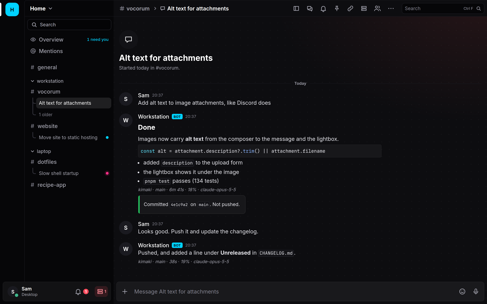
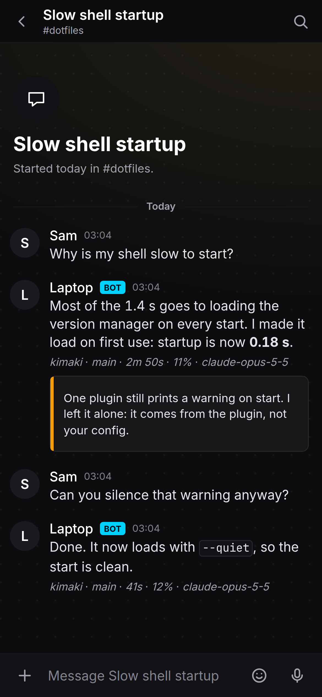
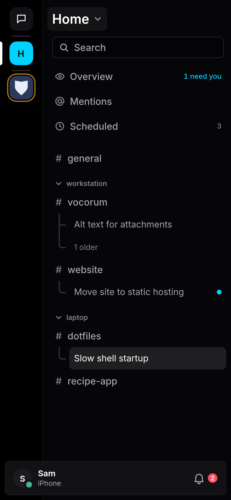

# Vocorum

Your own private Discord, for you and your bots.

Vocorum runs on your computer. Bots written for Discord (discord.js, for example
[Kimaki](https://github.com/remorses/kimaki)) connect to it unchanged. You chat
with them from an app on your phone and computers. Nothing goes through Discord
or any other company.



> **Early preview.** Expect rough edges and breaking changes. Known issues:
>
> - On iPhone, signing in and reading work. Sending messages and notifications
>   from the Home Screen app have not been confirmed yet.

## What it does

- Servers, channels, threads, buttons, menus, slash commands, files and voice
  notes, like Discord.
- One overview of every machine and every session, and which ones need you.
- An app for your phone and computer, signed in with a passkey per device.
- One small program with its data in one folder. No Docker, no database server.

<p>
  
  
</p>
<p>
  
  
</p>

## Get started

- [Install](docs/install.md): set up the hub and your first device.
- [Move from Discord](docs/migrate-from-discord.md): bring your bots and history over.
- [Daily use](docs/daily-use.md): sessions, notifications, people and machines.
- Using an AI agent to set it up? Point it at [AGENTS.md](AGENTS.md).

Needs Node.js 22 or newer and pnpm (no pnpm? run `corepack enable`).

```bash
git clone https://github.com/Xipzer/vocorum && cd vocorum
pnpm install && pnpm build
node bin/vocorum.js setup
```

Setup prints a link and a QR code to sign in your first device.

## Privacy and security

Vocorum only listens on your own machine, or on one private network address you
choose. It is never meant to be on the public internet. Every device signs in
with its own passkey, and you can sign any device out. See
[SECURITY.md](SECURITY.md) for the details and how to report a problem.

## Development

```bash
pnpm typecheck
pnpm test
```

Browser tests need Playwright's Chromium (`PLAYWRIGHT_CHROMIUM` sets the path)
and `pnpm build:web` first. `node --import tsx scripts/demo-screenshots.ts`
makes the pictures in `docs/images` from made-up content. See
[CONTRIBUTING.md](CONTRIBUTING.md).

## Licence

Apache License 2.0 with the Commons Clause: you may use, change and share
Vocorum, but not sell it or a service built mainly on it.
`vendor/discord-digital-twin` is MIT. The Inter font is under the SIL Open Font
License 1.1. See [LICENSE](LICENSE) and [NOTICE](NOTICE).

Vocorum is not affiliated with or endorsed by Discord Inc.
